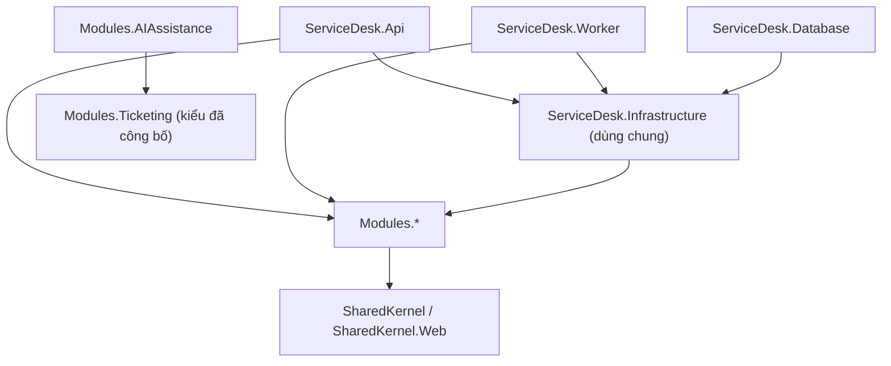
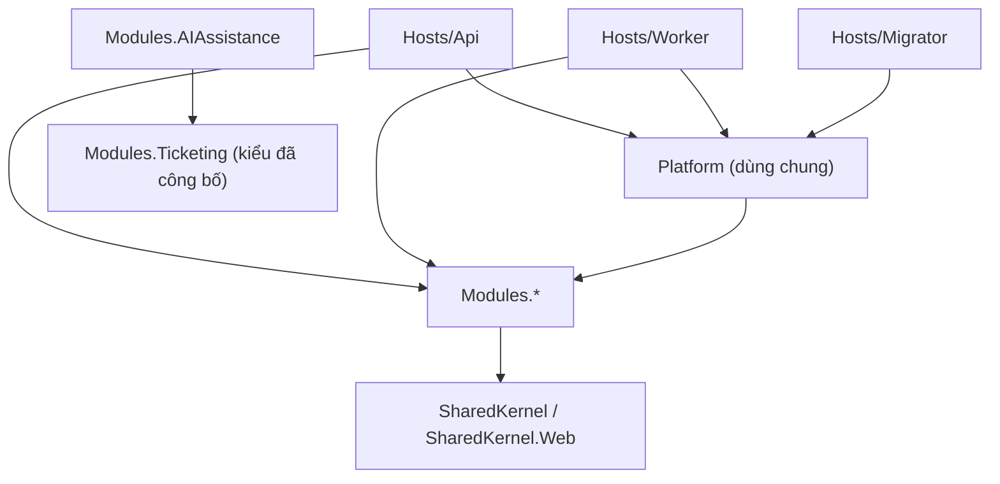

# ADR-015: Tổ chức theo module trước, Clean Architecture bên trong từng module

## Trạng thái

**Đã chấp nhận ngày 2026-11-13** theo chỉ dẫn của chủ dự án. Đề xuất ngày 2026-11-07 trên nhánh `refactor/backend-module-first`; mã đã hợp nhất vào `dev` (PR #50–#53) và CI (restore khóa phiên bản, build, unit, kiến trúc, integration PostgreSQL, build image) đạt. Cấu trúc thư mục được tinh gọn thêm ngày 2026-11-13, xem mục "Cập nhật cấu trúc thư mục". Thay thế phần tổ chức vật lý của [ADR-011](ADR-011-backend-module-boundaries.md) ("không đưa một dự án riêng cho mỗi mô-đun") và cách đặt module bên trong các tầng của [ADR-002](ADR-002-clean-architecture.md). Các luật nghiệp vụ, giao dịch và quyền trong ADR-011/014 giữ nguyên.

## Bối cảnh

Trước đợt này, backend chia theo tầng ở ngoài cùng (`ServiceDesk.Domain`, `ServiceDesk.Application`, `ServiceDesk.Infrastructure`, `ServiceDesk.Api`) và mỗi tầng lại chứa thư mục Identity, Ticketing, Knowledge, AIAssistance. Một thay đổi trong một module phải chạm bốn project; đăng ký DI của mọi module nằm chung ở `Application/DependencyInjection.cs` và `Infrastructure/DependencyInjection.cs`; endpoint nằm ở API, tách xa use case. Ranh giới module chỉ tồn tại bằng quy ước tên thư mục và danh sách trong kiểm thử kiến trúc.

## Quyết định

Đảo thứ tự: module là ranh giới ngoài cùng, Clean Architecture là cấu trúc bên trong mỗi module.

```text
src/backend/
  BuildingBlocks/
    ServiceDesk.SharedKernel/        # vai trò, actor hiện tại, đồng hồ, cổng lưu trữ, ngoại lệ nghiệp vụ dùng chung; không package
    ServiceDesk.SharedKernel.Web/    # thành phần HTTP dùng chung cho Presentation (bộ lọc lỗi)
  Modules/
    <Module>/          # Identity, Ticketing, Knowledge, AIAssistance
      ServiceDesk.Modules.<Module>.csproj
      Domain/            # thực thể, giá trị, quy tắc
      Application/       # một thư mục cho mỗi tính năng: interface, lệnh/truy vấn, use case internal; Contracts, Ports
      Infrastructure/    # adapter PostgreSQL/HTTP, cấu hình ánh xạ EF, options
      Presentation/      # endpoint và request body của module
      {Module}Module.cs  # điểm vào duy nhất: Add{Module}Module / Add{Module}Application / Add{Module}Infrastructure
  ServiceDesk.Infrastructure/  # hạ tầng kỹ thuật dùng chung: ApplicationDbContext, migration, bảo trì DB, MinIO, đồng hồ
  ServiceDesk.Api/             # host HTTP: composition root, middleware, health
  ServiceDesk.Worker/          # host nền
  ServiceDesk.Database/        # công cụ migration/seed
```

Chiều phụ thuộc giữa project:



Bên trong module, phụ thuộc chỉ đi vào trong: Presentation → Application → Domain và Infrastructure → Application → Domain. Domain và Application không dùng EF Core, Npgsql hoặc ASP.NET Core. [ModuleRules](../../tests/ServiceDesk.ArchitectureTests/ModuleRules.cs) cho AIAssistance dùng ba kiểu Ticketing trong `Published`: `TicketCategory`, `Impact`, `Urgency`. Host HTTP gọi điểm đăng ký và map route của module. Worker gọi điểm đăng ký module.

Các quyết định đi kèm:

- **Một project cho mỗi module, tầng tách bằng thư mục/namespace.** Project nằm trực tiếp trong `Modules/<Module>/`. Solution hiển thị tên module. Tên tệp `.csproj`, assembly và namespace giữ tiền tố `ServiceDesk.Modules.`. Ranh giới tầng trong module được kiểm bằng `ServiceDesk.ArchitectureTests` (IL qua Mono.Cecil và NetArchTest). Cách này giúp bốn module dùng bốn project và một bộ luật kiểm thử chung.
- **Một `DbContext` và một chuỗi migration giữ nguyên.** `ApplicationDbContext` vẫn ở `ServiceDesk.Infrastructure.Persistence` để migration đã phát hành không phải đổi. Context gom cấu hình ánh xạ từ assembly của Identity, Ticketing và Knowledge. Adapter trong module nhận `DbContext` (bí danh do host đăng ký) và dùng `Set<T>()`, nên module không phụ thuộc kiểu context cụ thể. Không đổi schema; chỉ cập nhật tên kiểu CLR trong model snapshot.
- **Module tự đăng ký.** Host gọi `AddInfrastructure` (chỉ hạ tầng dùng chung, không đăng ký module), rồi `AddIdentityModule(...).AddIdentityStores()`, `AddTicketingModule`, `AddKnowledgeModule`, `AddAIAssistanceModule`. `AddIdentityStores` truyền `ApplicationDbContext` cho phần lưu trữ của Identity vì module không biết kiểu context cụ thể. Thêm module mới không phải sửa module khác (Open/Closed).
- **`RoleNames`/`PolicyNames` chuyển vào SharedKernel.** Vai trò là khái niệm phân quyền xuyên module; nhờ vậy Ticketing và Knowledge không còn phải tham chiếu Identity.
- **Ngoại lệ nghiệp vụ dùng chung.** `ConflictException` (409) và `RetryLaterException` (503 + Retry-After) nằm trong SharedKernel; `ConcurrencyConflictException`, `IdempotencyConflictException`, `IdempotencyInProgressException` kế thừa chúng. Bộ lọc `ApiErrorFilter` chỉ biết các lớp cơ sở nên không phụ thuộc Ticketing và giữ nguyên mã trạng thái HTTP cũ.
- **Xác thực và phiên đăng nhập là trách nhiệm của Identity.** API gọi `AddIdentityAuthentication` để đăng ký JWT Bearer. Identity dùng chung cấu hình khi cấp và xác thực token. Tạo và thu hồi refresh token đi qua khóa dòng người dùng; đăng xuất và phát hiện token bị dùng lại thu hồi theo chuỗi phiên (`family_id`). Quy tắc chi tiết nằm ở [hợp đồng Identity](../architecture/current-backend-contract.md#identity-sau-pr-47-48-và-nhánh-refactor); module khác không đọc hay ghi bảng phiên.
- **Không đổi hợp đồng HTTP, hợp đồng AI v1, tên bảng, migration hay hành vi nghiệp vụ.** Đường dẫn route, tên schema OpenAPI và thứ tự đăng ký endpoint giữ nguyên.

## Cập nhật cấu trúc thư mục (2026-11-13)

Sau khi ADR được chấp nhận, hai đợt đổi tên và gom thư mục (PR #68, #70 và commit `07ce07a`) tinh gọn cấu trúc mà **không đổi** tên tệp `.csproj`, assembly, namespace, hợp đồng HTTP hay dữ liệu. Cấu trúc hiện hành:

```text
src/backend/
  Hosts/
    Api/           # host HTTP: composition root, middleware, health (ServiceDesk.Api)
    Worker/        # host nền (ServiceDesk.Worker)
    Migrator/      # công cụ migration và khởi tạo (ServiceDesk.Migrator)
  Platform/        # hạ tầng kỹ thuật dùng chung: ApplicationDbContext, migration, bảo trì DB, lưu trữ tệp, đồng hồ (ServiceDesk.Platform)
  BuildingBlocks/
    SharedKernel/      # ServiceDesk.SharedKernel
    SharedKernel.Web/  # ServiceDesk.SharedKernel.Web
  Modules/<Module>/    # Identity, Ticketing, Knowledge, AIAssistance (ServiceDesk.Modules.<Module>)
```

| Tại thời điểm quyết định (2026-11-07) | Hiện nay |
| --- | --- |
| `ServiceDesk.Infrastructure/` | `Platform/` |
| `ServiceDesk.Api/` | `Hosts/Api/` |
| `ServiceDesk.Worker/` | `Hosts/Worker/` |
| `ServiceDesk.Database/` | `Hosts/Migrator/` |
| `BuildingBlocks/ServiceDesk.SharedKernel(.Web)/` | `BuildingBlocks/SharedKernel(.Web)/` |



Các sơ đồ và cây thư mục ở mục "Quyết định" phía trên giữ nguyên làm bản ghi tại thời điểm quyết định.

## Hệ quả

Được:

- Toàn bộ code của một tính năng nằm trong một thư mục module; người mới đọc một module mà không phải nhảy qua bốn project.
- Đăng ký DI và endpoint của module nằm cạnh code của nó; Program.cs chỉ còn ghép module.
- Phụ thuộc giữa module thấy được ngay trong csproj (chỉ AIAssistance → Ticketing).

Mất/đánh đổi:

- Trong một module, Domain có thể biên dịch được khi lỡ dùng EF Core; vi phạm chỉ bị chặn khi chạy kiểm thử kiến trúc, không phải lúc biên dịch.
- Adapter dùng `DbContext` chung vẫn nhìn thấy toàn bộ model; ranh giới dữ liệu giữa module tiếp tục dựa vào kiểm thử kiến trúc. Ticketing tra người dùng qua `IUserDirectory` do Identity công bố; kiểm thử kiến trúc chặn module khác phụ thuộc `Microsoft.AspNetCore.Identity`.
- `ServiceDesk.Infrastructure` tham chiếu module để gom thực thể và cấu hình ánh xạ; đây là tầng ghép persistence, không chứa nghiệp vụ.

## Kiểm chứng cần có trước khi chấp nhận

- `dotnet restore --locked-mode`: lock file của project mới được sinh từ dữ liệu lock cũ vì môi trường viết thay đổi không có NuGet. Nếu restore báo lệch, chạy `dotnet restore src/backend/ServiceDesk.sln --force-evaluate`, review diff lock file, rồi commit.
- Build Release với `TreatWarningsAsErrors`, unit, kiến trúc, integration PostgreSQL thật (đặc biệt idempotency, revision và khóa đăng nhập), `ApiContractTests` so OpenAPI baseline, và `dotnet ef migrations has-pending-model-changes` không báo thay đổi.
