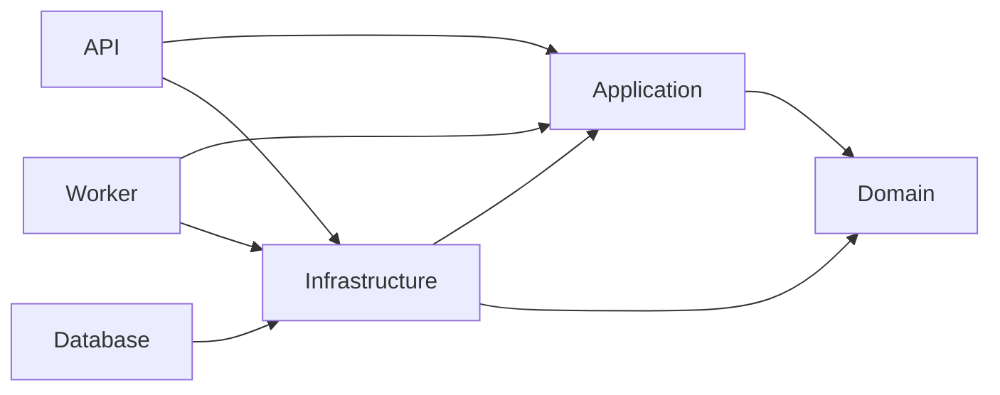

# Backend modules and feature use cases

Baseline: 9dd0746450dca4348d6d0fa8a09cfc2a48860020. Decision: ADR-014.

## Dependency graph

Infrastructure references from hosts are for composition. PostgreSQL readiness
registration lives in Infrastructure. Business HTTP handlers depend on published use
cases/DTOs, not persistence. Application references Domain and DI abstractions only.

## Ownership

| Module | Owns | Published/shared boundary |
|---|---|---|
| Identity | Registration, password verification, roles, login security state, own profile query | Register/login/self-query interfaces, request/result DTOs; role/policy names |
| Ticketing | Ticket validation, owner authorization, query scope, paging, atomic creation and receipts | Three use-case interfaces, commands/queries, ticket/page DTOs; category/impact/urgency values |
| AIAssistance | Classification input/result, confidence/triage policies, suggestion invariants, wire mapper | Application classifier/embedding ports for adapters; only category/impact/urgency may cross from Ticketing |

Common contains actor/clock/storage abstractions and actor identity validation, not
module entities or repositories. EF mappings belong to Infrastructure.Ticketing.
One shared DbContext retains the existing tables and model.

The exact published-type list and technical exceptions are executable in architecture
tests (ModuleRules). Public visibility alone does not grant cross-module access.
Use cases and adapter implementations are internal. Application.Tests and
IntegrationTests have narrowly scoped friend access to their respective assemblies.

## Six flows

| HTTP operation | Application feature | Adapter flow |
|---|---|---|
| POST /api/auth/register | IRegisterUser | Create Requester atomically, then issue token; client role ignored |
| POST /api/auth/login | ILoginUser | Normalize email, row-lock user, verify/update lockout, commit, then issue token |
| GET /api/auth/me | IGetCurrentUser | Require actor GUID, look up only that subject; no caller-supplied ID |
| POST /api/tickets | ICreateTicket | Require actor/role, construct Domain ticket, invoke atomic writer |
| GET /api/tickets/me | IGetMyTickets | Require actor/role, validate paging, query own tickets and count |
| GET /api/tickets/{id} | IGetTicketDetail | Require actor/role, derive explicit scope, query visible ticket |

Each module has feature folders containing its contract, input and internal use-case
implementation, plus Contracts and Ports folders. Calls use ExecuteAsync directly via
DI; there is no mediator or separate read database.

## Authorization and transactions

Requester detail uses OwnTickets(actorId); Agent/Admin uses AllTickets. Multi-role
staff retain the broader detail grant. Create/list always use the actor's own ID.
Null/unknown scope fails closed. Missing or invisible ticket returns 404.
This release does not implement team membership, assignment scope or privilege revocation
of already issued JWTs.

User ID validity is checked in Application, independently of HTTP middleware. Worker
registers an anonymous actor, not HttpContext, so actor-required use cases reject calls.
The self-profile query preserves missing-user 404 and rejects malformed actor identity.

Login uses a READ COMMITTED transaction and FOR UPDATE per account. A fresh no-tracking
snapshot is merged into an existing tracked user instance when needed. Failed counts,
lockout and successful reset are written while holding that lock. Write errors roll
back and remain server errors; they do not masquerade as a recorded bad password.
Cancellation is checked before commit and token issuance.

Ticket creation keeps the full transaction, advisory lock, receipt write and exact
replay in ITicketWriter's PostgreSQL adapter. Receipt database time, ten-minute TTL,
five-second lock timeout, fingerprint encoding and ownership check are unchanged.

## AI boundary

Application owns TriageRequest/TriageResult and ports; Infrastructure owns v1 wire DTOs,
explicit enum maps and JSON validation. Results have controlled construction and
immutable fields/error collections. Caller cancellation is propagated, not converted
to Unavailable. NoOp returns no invented scores; offline Fake adapters live only in tests.

Domain enforces valid snapshot IDs/revision/hash, suggestion parent ownership,
one suggestion per field, known enum/value pairs and terminal decisions. Input hash
v2 is documented with a golden vector in contracts/ai/v1/README.md. The v1 wire hash
is opaque and echoed; the OpenAPI file is unchanged. No live provider, AI endpoint,
AI persistence, lifecycle/SLA or profile migration is introduced.
