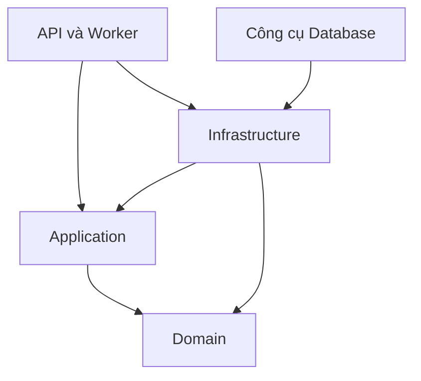

# Mô-đun backend và luồng xử lý nghiệp vụ

Trạng thái: mô tả hiện hành. Đối chiếu mã `dev` tại `47634bc8162c13bd6ae024233ec24a0076738c51`, sau PR #28 và #29; cập nhật 2026-10-20. Quyết định nền tảng: [ADR-011](../adr/ADR-011-backend-module-boundaries.md), [ADR-014](../adr/ADR-014-feature-use-cases-and-published-contracts.md). Quyền và phản hồi HTTP chi tiết ở [hợp đồng hiện hành](current-backend-contract.md). Mốc đối chiếu không khẳng định bản làm việc của người đọc đã chứa commit này.

## Chiều phụ thuộc

Mười hai luồng trong tài liệu thuộc mốc dev đã ghim; bản local trước PR #28 chỉ có sáu luồng. Đối chiếu [bảng mốc nguồn](source-baseline.md) trước khi chạy hoặc đọc liên kết mã tương đối.

API/Worker tham chiếu Infrastructure để lắp ghép dịch vụ. Đăng ký kiểm tra PostgreSQL sẵn sàng thuộc Infrastructure. Hàm xử lý HTTP gọi giao diện nghiệp vụ và DTO được công khai. Application chỉ tham chiếu Domain và các giao diện hỗ trợ đăng ký phụ thuộc; không sử dụng EF Core hoặc ngữ cảnh HTTP.

## Trách nhiệm từng mô-đun

| Mô-đun | Sở hữu | Giao diện hoặc kiểu được công khai |
| --- | --- | --- |
| Identity | Đăng ký, mật khẩu, vai trò, bảo vệ đăng nhập và truy vấn hồ sơ bản thân | Ba giao diện nghiệp vụ, dữ liệu yêu cầu/kết quả; tên vai trò và quy tắc HTTP |
| Ticketing | Kiểm tra phiếu, quyền chủ sở hữu, phạm vi truy vấn, phân trang, tạo phiếu nguyên tử và các thao tác vòng đời | Chín giao diện nghiệp vụ, lệnh/truy vấn, DTO phiếu và trang; các kiểu danh mục, mức ảnh hưởng, mức khẩn cấp |
| AIAssistance | Đầu vào/kết quả phân loại, độ tin cậy, bất biến đề xuất và chuyển đổi hợp đồng AI | Cổng phân loại/biểu diễn vectơ; các kiểu Ticketing được cho phép rõ ràng |

`Common` chứa giao diện danh tính hiện tại, đồng hồ, lưu trữ và kiểm tra định danh dùng chung. Nó không chứa thực thể phiếu hoặc kho dữ liệu của mô-đun khác. Ánh xạ EF thuộc `Infrastructure.Ticketing`. Một `DbContext` dùng chung giữ các bảng và mô hình hiện có.

Danh sách kiểu được phép truy cập xuyên mô-đun và ngoại lệ kỹ thuật nằm trong [ModuleRules](../../tests/ServiceDesk.ArchitectureTests/ModuleRules.cs). Khai báo `public` không tự cấp quyền truy cập. Lớp triển khai nghiệp vụ và bộ tích hợp là `internal`; quyền truy cập nội bộ dành cho kiểm thử được giới hạn theo assembly.

## Mười hai luồng đã triển khai

Đây là số luồng nghiệp vụ, không phải tổng số đường dẫn chẩn đoán hoặc kiểm tra sức khỏe.

| Thao tác HTTP | Giao diện Application | Xử lý chính |
| --- | --- | --- |
| `POST /api/auth/register` | `IRegisterUser` | Tạo tài khoản và vai trò Requester nguyên tử, sau đó cấp token; bỏ qua vai trò bên gọi tự chọn |
| `POST /api/auth/login` | `ILoginUser` | Chuẩn hóa email, khóa dòng tài khoản, xác minh/cập nhật trạng thái đăng nhập, commit rồi cấp token |
| `GET /api/auth/me` | `IGetCurrentUser` | Lấy đúng định danh người đang đăng nhập; không nhận ID thay thế |
| `POST /api/tickets` | `ICreateTicket` | Kiểm tra danh tính/vai trò, tạo thực thể Domain và ghi nguyên tử |
| `GET /api/tickets/me` | `IGetMyTickets` | Kiểm tra phân trang; chỉ truy vấn phiếu của người đang đăng nhập |
| `GET /api/tickets/{id}` | `IGetTicketDetail` | Xác định phạm vi nhìn thấy rõ ràng rồi truy vấn phiếu |
| `POST /api/tickets/{id}/update` | `IUpdateTicket` | Chủ sở hữu hoặc Admin cập nhật phiếu ở Submitted |
| `POST /api/tickets/{id}/claim` | `IClaimTicket` | Kiểm tra Agent; chuyển Submitted sang InProgress |
| `POST /api/tickets/{id}/resolve` | `IResolveTicket` | Agent/Admin chuyển InProgress sang Resolved |
| `POST /api/tickets/{id}/reopen` | `IReopenTicket` | Chủ sở hữu hoặc Admin chuyển Resolved sang InProgress |
| `POST /api/tickets/{id}/close` | `ICloseTicket` | Chủ sở hữu hoặc Admin chuyển Resolved sang Closed |
| `POST /api/tickets/{id}/cancel` | `ICancelTicket` | Chủ sở hữu hoặc Admin chuyển Submitted sang Cancelled |

Mỗi tính năng có thư mục chứa giao diện, dữ liệu đầu vào và lớp triển khai nội bộ; dữ liệu trao đổi dùng chung ở `Contracts`, cổng kỹ thuật ở `Ports`. Các lời gọi dùng trực tiếp `ExecuteAsync` qua đăng ký phụ thuộc. Chưa sử dụng bộ điều phối trung gian hoặc cơ sở dữ liệu đọc riêng.

## Quyền truy cập và các lệnh ghi

Truy vấn chi tiết dùng `OwnTickets(actorId)` cho Requester và `AllTickets` cho Agent/Admin, kể cả người có nhiều vai trò. Tạo/danh sách luôn theo người đang đăng nhập. Phạm vi null hoặc không hợp lệ bị từ chối; phiếu thiếu hoặc ngoài phạm vi trả 404.

Các lệnh ghi của PR #28 dùng `ITicketWriter.GetForUpdateAsync` tải thực thể rồi kiểm tra quyền riêng. Phương thức này chưa nhận `TicketReadScope`. Tên phương thức không chứng minh có khóa dòng: bộ tích hợp hiện dùng `SingleOrDefaultAsync`.

Các điểm cần xử lý được ghi trong [hợp đồng hiện hành](current-backend-contract.md#các-điểm-chưa-đạt-cần-xử-lý): quyền nhận xử lý Agent/Admin chưa thống nhất giữa HTTP và Application; giải quyết phiếu tải ID trước khi kiểm tra vai trò; lỗi ghi đồng thời chưa có ánh xạ phản hồi riêng.

Nhận xử lý chưa lưu người phụ trách. Mở lại chưa kiểm tra thời gian hoặc lịch sử giải quyết. Chưa có phân quyền theo nhóm, phân công hoặc thu hồi tức thời quyền trong JWT đã phát. Những giới hạn này tiếp tục theo [bảng quyết định](pending-business-decisions.md).

## Giao dịch và lưu dữ liệu

Application kiểm tra định danh người gọi độc lập với HTTP. Worker đăng ký danh tính ẩn danh; luồng yêu cầu người dùng phải từ chối khi được gọi từ ngữ cảnh đó.

Đăng nhập dùng giao dịch READ COMMITTED và `FOR UPDATE` trên từng tài khoản. Bộ tích hợp đồng bộ dữ liệu mới đọc vào thực thể đang được theo dõi nếu cần. Số lần sai, trạng thái khóa và đặt lại khi đăng nhập đúng được ghi trong thời gian giữ khóa. Lỗi ghi phải rollback; yêu cầu hủy được kiểm tra trước commit/cấp token.

Tạo phiếu với khóa chống tạo trùng giữ giao dịch, khóa PostgreSQL, biên nhận và phiếu trong cùng bộ tích hợp `ITicketWriter`. Hiệu lực biên nhận 10 phút theo giờ cơ sở dữ liệu; thời gian chờ khóa 5 giây. Thuật toán dấu vân tay, phạm vi chủ sở hữu và phản hồi phát lại được giữ nguyên.

Các lệnh vòng đời gọi quy tắc trên `Ticket`, sau đó `SaveChangesAsync`. Chưa có bản ghi lịch sử nghiệp vụ hoặc cơ chế chống lặp tương tự tạo phiếu cho các lệnh này. `xmin` phát hiện xung đột ở cơ sở dữ liệu; việc chuyển lỗi đó thành phản hồi nghiệp vụ còn cần hoàn thiện.

## Ranh giới AI

Application sở hữu `TriageRequest`, `TriageResult` và các cổng. Infrastructure sở hữu DTO truyền qua mạng của hợp đồng v1, ánh xạ enum và kiểm tra JSON. Kết quả có cách tạo được kiểm soát và dữ liệu bất biến. Yêu cầu hủy được truyền tiếp; NoOp không tự sinh điểm tin cậy. Bộ tích hợp giả chỉ nằm trong kiểm thử.

Domain kiểm tra định danh ảnh chụp dữ liệu, phiên bản, mã băm, quan hệ sở hữu đề xuất, giá trị enum và quyết định kết thúc. Thuật toán mã băm v2 có giá trị kiểm chứng trong [hợp đồng AI](../../contracts/ai/v1/README.md). Dịch vụ AI phải phản hồi mã băm và các định danh liên kết nguyên trạng.

Chưa có nhà cung cấp AI thật, API AI, dữ liệu AI được lưu, SLA hoặc dữ liệu hồ sơ đầy đủ. Việc bổ sung các phần đó thuộc quyết định và thay đổi riêng.
