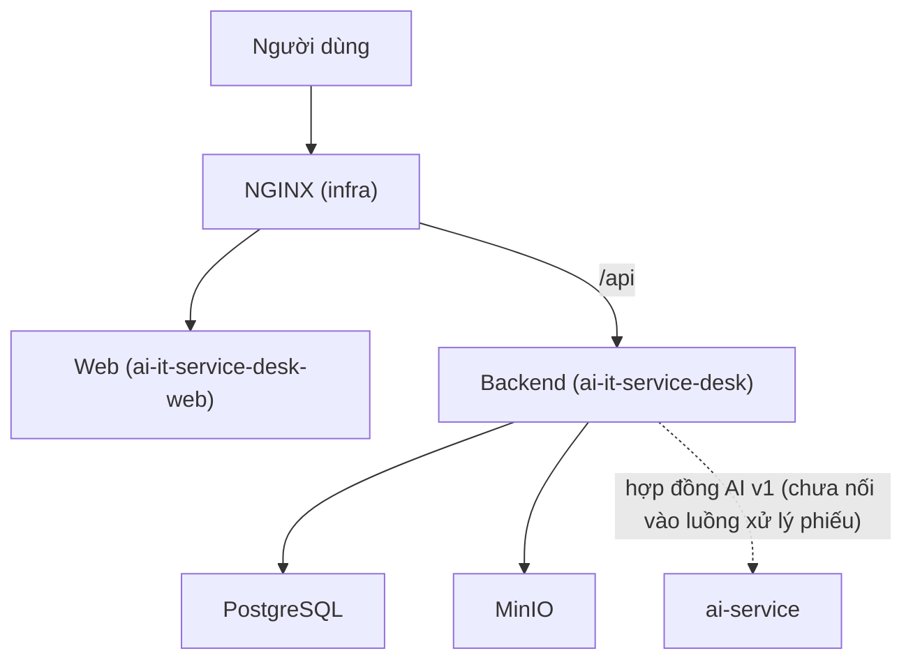

# Cẩm nang làm việc chung SupportFlow AI

**Bản chung, giống hệt nhau ở bốn kho.** Phiên bản 2026-11-13. Ai sửa file này ở một kho phải mở thay đổi giống hệt ở ba kho còn lại trong cùng đợt, để các bản không lệch nhau. Quy tắc riêng của từng kho nằm trong `AGENTS.md` của kho đó; khi hai nơi khác nhau thì quy tắc riêng của kho áp dụng cho kho đó.

Dành cho mọi thành viên: lập trình viên, người kiểm thử, người vận hành và trợ lý AI. Trợ lý AI tuân theo đúng các quy tắc như người, và đọc `AGENTS.md` của kho đang làm việc trước khi sửa.

## 1. Hệ thống và bốn kho

SupportFlow AI là hệ thống IT Service Desk: người dùng tạo phiếu hỗ trợ, nhân viên xử lý theo vòng đời phiếu, AI gợi ý phân loại. Ba vai trò người dùng: `Requester` (người yêu cầu), `Agent` (nhân viên hỗ trợ), `Admin`. Phạm vi MVP do chủ dự án quyết định gồm Identity và Ticketing.

| Kho | Vai trò | Công nghệ | Luồng nhánh |
| --- | --- | --- | --- |
| [`ai-it-service-desk`](https://github.com/supportflow-ai/ai-it-service-desk) | Backend: API, nghiệp vụ, phân quyền, schema và migration, hợp đồng HTTP và hợp đồng AI v1 | .NET 10, ASP.NET Core, EF Core, PostgreSQL | `nhánh làm việc → dev → main` |
| [`ai-it-service-desk-web`](https://github.com/supportflow-ai/ai-it-service-desk-web) | Giao diện web | React 19, TypeScript, Vite, Ant Design | `nhánh làm việc → dev → main` |
| [`ai-service`](https://github.com/supportflow-ai/ai-service) | Dịch vụ gợi ý phân loại phiếu và tạo embedding bằng mô hình học máy cục bộ; không có database, không gọi API bên ngoài | Python 3.12, FastAPI | `nhánh làm việc → main` |
| [`supportflow-ai-infra`](https://github.com/supportflow-ai/supportflow-ai-infra) | Docker Compose, NGINX, ghim phiên bản phát hành, kiểm thử khói toàn hệ thống | Docker Compose, NGINX, Python, Shell | `nhánh làm việc → main` |



Ranh giới sở hữu:

- **Backend** sở hữu dữ liệu, quyền nghiệp vụ, trạng thái phiếu và mọi quyết định áp dụng gợi ý AI. Web chỉ hiển thị và không phải ranh giới bảo mật; ẩn nút không thay cho kiểm tra quyền ở backend.
- **ai-service** chỉ nhận yêu cầu nội bộ giữa các dịch vụ, trả gợi ý. Phân loại và embedding chạy bằng mô hình học máy cục bộ; **không gọi API hay dịch vụ model bên ngoài**. Không kết nối database nghiệp vụ, không đổi phiếu, quyền hay luồng xử lý.
- **infra** không chứa mã ứng dụng hay migration. Nó ghép các thành phần và kiểm chứng chúng chạy cùng nhau.

## 2. Bắt đầu nhanh

Đặt bốn kho cạnh nhau trong cùng một thư mục, đúng tên kho, vì Compose của infra tìm các kho khác qua đường dẫn `../<tên-kho>`.

| Cần | Phiên bản |
| --- | --- |
| .NET SDK | Theo `global.json` của backend |
| Node.js | 22 (xem `.nvmrc` của web) |
| Python | 3.12 |
| PostgreSQL | 17, image `pgvector/pgvector` 0.8.1 |
| Docker | Cần cho PostgreSQL local, MinIO, kiểm thử tích hợp backend và build image |

Chạy local theo thứ tự (mỗi bước một terminal; lệnh chi tiết ở README của từng kho):

1. **infra**: `docker compose up -d` chạy PostgreSQL 17 (pgvector), MinIO và Mailpit.
2. **backend**: restore và build, chạy `migrate` rồi `seed-roles` bằng công cụ Migrator khi database mới, sau đó khởi chạy API tại cổng 5000.
3. **ai-service** (tùy chọn, chỉ khi cần thử hợp đồng AI): `uvicorn` tại cổng 8000.
4. **web**: `npm ci` rồi `npm run dev` tại cổng 5173; Vite chuyển `/api` sang cổng 5000.

Không có bước nào bắt buộc phải chạy cả bốn kho. Phát triển một kho thường chỉ cần kho đó cộng PostgreSQL.

## 3. Nhánh, commit và Pull Request

**Nhánh.** Tên dạng `<loại>/<mô-tả-ngắn-không-dấu>`, ví dụ `fix/chan-truy-cap-phieu-ngoai-pham-vi`. Loại: `feature`, `feat`, `bugfix`, `fix`, `chore`, `refactor`, `hotfix`, `docs`, `test`; nhánh phát hành dùng `release/<phiên-bản>`. Tạo nhánh từ `dev` ở backend và web, từ `main` ở ai-service và infra. Khi người giao việc chỉ định một nhánh cụ thể, giữ nhánh đó dù tên không theo mẫu.

**Commit.** Dạng Conventional Commits, mô tả bằng tiếng Việt có dấu:

```text
<loại>(<phạm vi>): <mô tả tiếng Việt>
```

Ví dụ: `fix(ticketing): chặn truy cập phiếu ngoài phạm vi`. Mỗi commit một ý. **Không bắt buộc mã công việc (Jira hoặc công cụ khác) trong tên nhánh, commit hay tiêu đề PR.** Khi công việc có mã hoặc liên kết thì ghi vào mô tả PR để truy vết; không tự bịa mã. Lịch sử cũ giữ nguyên, không viết lại.

**Pull Request.** Tiêu đề cùng dạng với commit. Mô tả nêu: vấn đề và hành vi sau thay đổi; phạm vi chịu ảnh hưởng; lệnh kiểm tra đã chạy cùng kết quả và SHA; phần chưa chạy kèm lý do; ảnh hưởng tới kho khác (mục 4); cách rollback nếu có tác động tới dữ liệu hay vận hành.

**Duyệt và hợp nhất.** CI của kho phải đạt trên commit mới nhất của PR. Cần ít nhất một người khác đánh giá; không tự phê duyệt PR của mình. Từ 2026-11-13 GitHub bảo vệ nhánh `main` ở cả bốn kho và `dev` ở backend và web: phải đi qua PR, cần 1 phê duyệt, cấm force-push và xóa nhánh. Quét bí mật và push protection cũng đã bật. Quản trị viên của kho vẫn vượt qua được (chưa bật áp dụng cho quản trị viên), chưa có CODEOWNERS và chưa đặt kiểm tra trạng thái bắt buộc, nên người có quyền quản trị phải tự giữ quy tắc.

Không force-push nhánh dùng chung, không viết lại lịch sử đã đẩy lên GitHub.

## 4. Thay đổi ảnh hưởng kho khác

Khi sửa một trong các mục ở cột trái, báo và sửa ở kho còn lại trong cùng đợt, hoặc ghi rõ trong PR là việc đồng bộ chưa làm.

| Bạn thay đổi | Kho khác phải làm gì |
| --- | --- |
| Đường dẫn, tham số, mã phản hồi hay DTO của API backend (`contracts/backend/openapi-baseline.json`) | **web** cập nhật snapshot `tests/contracts/backend-openapi.json` và `backend-source.json`, chạy `npm run contract:generate` rồi `npm run contract:check` |
| Hợp đồng AI v1 (`contracts/ai/v1/openapi.yaml`) | **ai-service** cập nhật bản sao cùng đường dẫn và `contract.lock.json` (SHA nguồn và hash); CI của ai-service kiểm tra khớp từng byte |
| Đường dẫn Dockerfile, tên project hay image, biến môi trường của backend | **infra** cập nhật Compose và workflow tham chiếu chúng |
| Migration hoặc schema | Chỉ backend sở hữu; chạy qua công cụ Migrator. **infra** kiểm chứng bằng smoke migrate, seed và khởi động API/Worker |
| Cổng, tên dịch vụ, route NGINX | **web** (proxy `/api`) và **backend** (CORS, địa chỉ nội bộ) |
| Nâng phiên bản phát hành | Chỉ **infra** ghim: `sources.lock.json` chứa SHA của backend, web, ai-service và digest của năm image. Chỉ nâng khi có quyết định phát hành |

Smoke toàn hệ thống thuộc infra và phải dùng đúng SHA của kho được kiểm chứng; kết quả của SHA cũ không chứng nhận SHA mới.

## 5. Giới hạn an toàn

- Không đưa bí mật vào Git, nhật ký, ảnh chụp hay chat: mật khẩu, token, khóa JWT, chuỗi kết nối, khóa SSH. Cấu hình lấy từ môi trường hoặc kho bí mật. Không ghi thông tin cá nhân hay nội dung phiếu vào log.
- Không thao tác lên staging, production hay database dùng chung khi chưa được yêu cầu rõ lệnh và đích. Không chạy lệnh làm mất dữ liệu (`reset --hard`, `clean`, xóa volume, hạ migration, `down -v`) trên dữ liệu thật hoặc khi chưa kiểm tra đích.
- Không sửa test, fixture, snapshot hay baseline để làm CI xanh hoặc hợp thức hóa lỗi. Không bỏ qua hay hạ cảnh báo để build đạt.
- Mặc định giữ tương thích API và dữ liệu đã lưu. Không đổi nghĩa enum đã lưu, không sửa hay đổi thứ tự migration đã phát hành.
- Không tự push, hợp nhất PR hay triển khai khi chưa được giao. Không kết nối dịch vụ AI thật ngoài nhiệm vụ.
- Quyết định nghiệp vụ hay chính sách (quyền theo vai trò, vòng đời phiếu, phạm vi MVP) thuộc chủ dự án. Khi gặp, nêu các lựa chọn và tác động, giữ nguyên hành vi hiện tại và hỏi; tiếp tục phần độc lập.

## 6. Hoàn thành và bàn giao

Công việc hoàn thành khi:

1. Làm đúng phần được giao; nêu rõ giới hạn và rủi ro còn lại.
2. Các kiểm tra phù hợp với thay đổi đã chạy và đạt, có bằng chứng gắn với SHA; kiểm tra chưa chạy phải nêu lý do và không được báo là đạt.
3. CI của PR đạt; có người khác đánh giá.
4. Tài liệu chịu ảnh hưởng đã cập nhật bằng tiếng Việt, hoặc PR ghi lý do không cần cập nhật.
5. Không có bí mật trong mã, tài liệu hay nhật ký.

CI đạt không tự chứng minh đã nghiệm thu đầy đủ, và nhãn `APPROVED` hay `Proposed` trong một tài liệu không chứng minh tính năng đã triển khai.

Bàn giao ngắn gồm: phạm vi chính; cách sửa và hợp đồng chịu ảnh hưởng; lệnh đã chạy, số test và kết quả; kiểm tra chưa chạy và lý do; giới hạn còn lại; nhánh, SHA và trạng thái push hay PR.

## 7. Tài liệu theo kho

| Kho | Đọc trước |
| --- | --- |
| Backend | `AGENTS.md`, `README.md`, `docs/README.md` (bản đồ tài liệu), `docs/architecture/current-backend-contract.md` (hợp đồng đang áp dụng), `docs/process/` (quy ước, DoR/DoD) |
| Web | `AGENTS.md` (kiến trúc và quy tắc), `README.md`, `docs/architecture/api-baseline.md` |
| ai-service | `AGENTS.md`, `README.md`, `docs/architecture.md`, `docs/backend-alignment.md` |
| infra | `AGENTS.md`, `README.md`, `docs/project/` (phạm vi MVP và đối chiếu API, quyền), `docs/infra/` (ranh giới, chạy local, vận hành), `deploy/README.md` |
